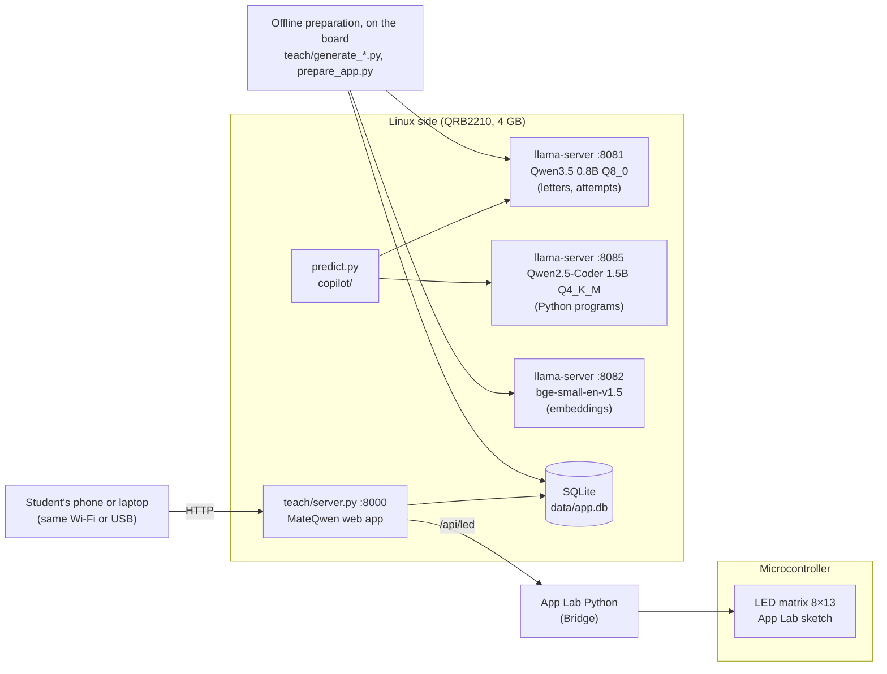

# MateQwen: a Kangaroo math copilot that lives on an Arduino UNO Q

**Datathon FME 2026 · Qualcomm challenge "Math on the Edge"**

MateQwen is a math copilot that runs entirely on an Arduino UNO Q (4 GB), offline. It does both things the challenge asks for:

- **Teach:** a web app, served by the board, where students train with Kangaroo problems from [M3Kang](https://huggingface.co/datasets/qualcomm/M3Kang). There are two modes. In *Solve it yourself*, the student types the number and can unlock help one rung at a time. In *Correct Qwen*, the student finds the step where the small model went wrong. The help never gives the answer away.
- **Reason:** `predict.py` answers Kangaroo problems with one letter, A to E, in under 60 seconds each. It combines a fast letter from a small language model, a Python program written by a code model, and what M3Kang tells us about where the correct answer usually hides.

Nothing leaves the device: no cloud, no API keys, no student data sent anywhere.

**📘 Arduino Project Hub write-up:** [MateQwen on Project Hub](https://projecthub.arduino.cc/projects/7287480c-bc2e-4546-b80d-d28c19dfed48/preview)

**▶️ Demo video:** the board, the MateQwen app and the LED matrix working, all offline.

[](https://youtu.be/bGllMtkxChU)

---

## Contents

1. [Architecture](#architecture)
2. [How we use M3Kang](#how-we-use-m3kang)
3. [Teach: the MateQwen app](#teach-the-mateqwen-app)
4. [Reason: predict.py](#reason-predictpy)
5. [Results](#results)
6. [Error analysis](#error-analysis)
7. [What didn't work](#what-didnt-work)
8. [How to replicate it](#how-to-replicate-it)
9. [Repository map](#repository-map)
10. [Team, credits and license](#team-credits-and-license)

---

## Architecture

The UNO Q has two brains: a Qualcomm QRB2210 (quad-core Arm, Debian Linux) and a real-time microcontroller that drives the 8×13 LED matrix.



- **Three model servers** run as systemd services that start at boot (`board/systemd/`). Versions and SHA256 are pinned in [`config.env`](config.env).
- **While a student plays, no model runs.** The models do their slow work ahead of time, on the board: attempts, verified worked solutions, topics and similar problems. The results go into SQLite, so every click in the app answers in milliseconds.
- **The LED matrix** shows what the student does: a new problem, a step marked, a hint used, right or wrong. An App Lab app (`teach/applab/canguro-led/`) polls `/api/led` and draws one frame per event. It runs in a container and reads the game at `http://172.17.0.1:8000/api/led`.

## How we use M3Kang

| Use | Where |
| --- | --- |
| **Problem bank** for the game, in English and Catalan (same `id`) | `teach/prepare_app.py` |
| **Topic map**: each problem gets one of six topics (Arithmetic, Algebra, Geometry, Counting, Logic, Numbers) by comparing its embedding with short descriptions of each topic | `teach/kinds.py`, `analyse_errors.py` |
| **Difficulty map**: levels 0–7 grouped into three tiers, each with bronze, silver and gold medals | `teach/kinds.py` |
| **Similar easier problem**: the nearest neighbour in the embeddings at a lower level, used as a help rung | `teach/prepare_app.py` |
| **Verified worked solutions**: a math model solves each problem without seeing the answer, and only solutions that reach the right answer are kept. Their steps become the hints | `teach/generate_worked.py` |
| **Wrong attempts to correct**: Qwen 0.8B's step-by-step attempts, which are almost always wrong, become the *Correct Qwen* exercises | `teach/generate_solutions.py` |
| **A prior over the answer**: Kangaroo setters place distractors around the right answer. Among five numeric options sorted from smallest to largest, the middle one is correct 29% of the time and the smallest only 10% (1,466 training problems). `predict.py` uses this to correct the model's letter bias | `copilot/priors.py` |

We don't publish any M3Kang data: `data/`, `*.db` and the images are in `.gitignore`. Please cite Torres-Camps et al., 2026, [arXiv:2601.16218](https://arxiv.org/abs/2601.16218).

## Teach: the MateQwen app

A single web page ([`teach/static/index.html`](teach/static/index.html)), with no libraries and nothing loaded from the internet, served by [`teach/server.py`](teach/server.py) at `http://<board-ip>:8000`.

- **Solve it yourself** (*Resuélvelo tú*): the student types the number, or a calculation such as `40/20*3`. No options are shown, so guessing doesn't work. When stuck, a ladder of help unlocks one rung at a time:
  1. a similar, easier problem to try first;
  2. the next step of a verified worked solution, one step at a time, never the step that states the answer.
- **Correct Qwen** (*Corrige a Qwen*): the student sees how Qwen 0.8B tried the problem step by step, marks the step where it goes wrong, and gives the right answer. This turns the small model's weakness into the exercise.
- **Progress:** a hexagon radar of the six topics, three tiers per topic with medals, streaks ("no hints" and "first try"), and a chart of points over time. Points depend on the tier, on how much help was used, and on the number of attempts.
- **Privacy:** the student logs in with a name only. Everything stays in `data/app.db` on the board.
- **Measured inside the app:** `POST /api/report` gives, for each kind of help, how often students solved the problem right after using it.

**What we have measured so far, honestly:**
- The app holds 131 problems: 38 with a verified worked solution for the step-by-step help, and 40 with a similar easier problem. All of them have the Catalan text.
- Qwen 0.8B got only 8 of its 131 attempts right. That is bad for answering, but it gives plenty of *Correct Qwen* exercises.
- The only users so far are the team, testing: 33 plays. In those, the problem was always solved after a help rung (2/2 similar problem, 2/2 solution step, 1/1 Qwen attempt).
- That is far too little to claim the help teaches. A study with real students is the next step.
- We also found a weak spot by playing: the first step of a worked solution often only restates the question. The useful plan starts at step 2.

Details, the API and the design rules are in [`teach/README.md`](teach/README.md).

## Reason: predict.py

`predict.py` is the official entry point. It reads a JSONL of problems and writes one letter per problem. The strategy is chosen with `STRATEGY` in `config.env`.

### `cascade`
1. **Fast letter** (~9 s): Qwen3.5 0.8B reads the problem and the options and writes one letter. A grammar forces the output to be A–E.
2. **Program** (with the time left): Qwen2.5-Coder 1.5B writes a short Python program that prints the answer. We run it in an isolated Python with a 3 s limit. If what it prints is exactly one of the five options, that option replaces the letter. A wrong program rarely lands on one of five given values, so this check is almost free.
3. **Time:** each step plans its token budget from the board's measured speeds, and streaming is cut at the deadline so the server is never left busy.

### `combo` (cascade + M3Kang prior)
The same steps, but the letter is no longer taken as is:

1. **Prior** (0 s): the probability of each letter before reading the problem. For five numbers it depends on the rank of each option; otherwise it is the letter frequency. This is also the answer if everything else times out, instead of always `D`.
2. **Vote:** we ask the letter model for its log-probabilities (`top_logprobs`) and multiply them by the prior (`PRIOR_WEIGHT`). This corrects the model's bias: on our test it **never answered E**, although E was right in 13 of 64 problems.
3. **Program:** as in cascade; it wins when it hits an option.

Two more steps exist in the code, but are **off** because they didn't help (see [What didn't work](#what-didnt-work)): a lexical memory of solved problems (`USE_MEMORY`), and an option checker `ok(x)` (`USE_CHECKER`).

Tests of the decision logic, with the models replaced by fakes: `python3 -m unittest tests.test_combo -v` (22 tests).

## Results

All runs on the UNO Q 4 GB, with the services from `config.env`, 60 s limit per problem, seed 42.

| Run | Problems | Accuracy | Mean / worst time |
| --- | --- | --- | --- |
| Always `D` | 1,466 training | 25.0% | 0 s |
| Organizers' baseline: one letter | 40 English val | 22.5% (9/40) | 8.7 / 12.7 s |
| One letter, our board | 50 val | 30.0% (15/50) | 8.5 / 16.1 s |
| One letter + 1 RAG example | the same 50 | 32.0% (16/50) | 20.1 / 30.4 s |
| Prior alone, no model (laptop) | 281 val | 28.1% | 0 s |
| One letter (`STRATEGY=letter`) | 100 practice (50 eng + 50 cat) | 25/100 | — |
| **`cascade`** | 100 practice (50 eng + 50 cat) | **42/100** | — / 54 s |
| `cascade` | 39 val, balanced by level* | 13/39 (33%) | 24.8 / 54.0 s |
| **`combo`** (prior + vote + program) | the same 39 | **14/39 (36%)** | — |
| `combo` | 64 val, 8 per level 0–7 | 22/64 (34.4%) | 26.0 / 54.0 s |
| `combo`, letter only, no prior (replayed) | the same 64 | 20/64 (31.2%) | — |
| Checker `ok(x)` instead of the program | 10 numeric val | 1/10 (`combo`: 5/10) | 44.0 / 52.2 s |

\* The cascade run on the balanced sample was stopped after 39 of 64 problems. On those 39, combo kept every problem cascade got right and won one more.

| `combo` (partial run, stopped) | first 23 of the 100 practice problems | 9/23 (39%) | 41.5 / 54.0 s |

**Pre-exam check** (`./board/06_exam_check.sh`, 2026-11-15, final commit, `STRATEGY=combo`): all checks passed.
- Four services running and enabled at boot, with 2.5 GB of RAM free.
- 6 practice problems: 4 right, 3 of them answered by a program, slowest 52.1 s.
- Awkward inputs (no options, empty options, word options, OCR noise, four options): always a letter.
- Letters still come back with the code model down.
- The MateQwen end-to-end API test passes.

**Honest reading.** The practice set (42/100) is easier than a sample balanced across all eight levels (33–34%). Both strategies are well above the baseline and the floor. On the same problems, combo beats cascade by one problem, which is within the noise. Its real gain is that it corrects the letter bias at no cost in time. Every run stayed under 60 s per problem. **`combo` is the strategy in `config.env` for the official run.**

## Error analysis

`python3 analyse_errors.py results/eval-<time>-combo.csv --problems <the input file>` gives these tables (combo, 64 val problems balanced by level):

**By topic** (the topic given by the embeddings, see above)

| Topic | Correct | Problems | Accuracy |
| --- | --- | --- | --- |
| Numbers | 10 | 19 | 53% |
| Counting | 4 | 8 | 50% |
| Arithmetic | 1 | 2 | 50% |
| Algebra | 2 | 9 | 22% |
| Geometry | 5 | 26 | 19% |

**By difficulty (level)**

| Level | 0 | 1 | 2 | 3 | 4 | 5 | 6 | 7 |
| --- | --- | --- | --- | --- | --- | --- | --- | --- |
| Correct / 8 | 6 | 4 | 4 | 1 | 1 | 1 | 3 | 2 |

**By where the answer came from**

| Source | Correct | Problems | Accuracy |
| --- | --- | --- | --- |
| Program hit an option | 6 | 8 | 75% |
| Vote (letter × prior) | 16 | 55 | 29% |

**By language** (combo, the first 23 practice problems; the validation set is English only)

| Language | Correct | Problems | Accuracy |
| --- | --- | --- | --- |
| English | 5 | 12 | 42% |
| Catalan | 4 | 11 | 36% |

This is a small sample: one problem more or less moves Catalan by 9 points. Catalan is a little lower, as expected: both models were trained mostly on English. Translating Catalan to English first (`TRANSLATE_CAT=1`) was tried and not used.

**What goes wrong:**

- **Geometry is the weakest topic (19%), and it is the largest** (26 of 64). Most of these problems depend on a figure the text models never see, and often the options are in the picture too (25 of 64 problems have no text options). In the organizers' test of the vision projector, only the smaller images fit in 60 s.
- **When the program answers, it is right 75% of the time**, but it only answers in 8 of 64 problems. It needs five numeric options and a problem a short program can brute-force (digits, counting, sums).
- **Letter bias:** the letter model chose `D` 27 times and `A` 20 times, `C` 4 times and `E` never, while each appeared about 13 times. The prior moves some of these answers, which is where combo's gain comes from.
- **Levels 3–5 are the hardest for us (3/24)**, harder than levels 6–7 in this sample: more multi-step reasoning, and fewer problems that a program can brute-force.

### Ten wrong answers, one by one

From the combo run on 64 val problems. We describe the problems instead of quoting them (M3Kang license).

| Problem | Level | Kind of problem | Why we got it wrong |
| --- | --- | --- | --- |
| `lvl-0_2024_1` | 0 | Which drawn square is cut into two different shapes | **Options are pictures.** The model never sees them, so it guesses (B 34%, A 32%). |
| `lvl-3_2018_11` | 3 | Which square has the largest black area | **Options are pictures.** Same as above. |
| `lvl-2_2017_24` | 2 | Smallest box for a figure made of 10 cubes | **Figure + OCR.** The shape is only in the figure, and OCR garbled the options (`4X4×5`, `4 4X4X4`), so they are not numbers and no program runs. |
| `lvl-2_2017_20` | 2 | Fill 10 circles joined by segments, even next to odd | **Figure.** A program could count this by brute force, but only if it knew which circles are joined. The model was split 50/50 between A and D (right). |
| `lvl-7_2023_28` | 7 | Numbers 1–11 in hexagons with equal sums around dots | **Figure + options in the picture.** |
| `lvl-5_2011_13` | 5 | Add one square to an L shape to get a symmetry axis | **Figure.** Five numeric options, but the program cannot model the shape. The model gave almost no weight to C (right), so the prior for the middle option was not enough. |
| `lvl-4_2018_11` | 4 | Cut a square into three equal areas, find a length | **Figure + OCR noise.** Labels from the drawing leaked into option E (`1 cm N B`). The program did not land on an option. |
| `lvl-5_2012_6` | 5 | In which expression can every 8 be replaced without changing the result | **Options are expressions, not numbers**, so no program runs. A program could test each expression in one line: an easy improvement. |
| `lvl-3_2021_15` | 3 | Three pirates, each tells one truth and one lie | **Text-only, but OCR missed the options.** A program could solve it by brute force, but it can't check its result against options it doesn't have. |
| `lvl-6_2022_6` | 6 | "I am smaller than my half and larger than my double…" | **Text-only, but OCR missed the options.** The answer is a one-line calculation (−1), but without options we can't turn it into a letter. |

**What the ten have in common:**
- **7 of 10 depend on the figure**, or have their options in the picture.
- **3 are lost to OCR**: options missing or garbled.
- **None is a case where the program answered and was wrong.**

So the next gains are better reading of the options (OCR) and programs for options that are expressions. A better reasoning model would matter less.

## What didn't work

We report these as plainly as what worked. All are measured on the board.

| Idea | Result | Decision |
| --- | --- | --- |
| **Option checker**: the code model writes `ok(x)`, and we try it on the five options | Alone on 10 problems: it decided 6 and got all 6 wrong (1/10, against 5/10 with the program). The model writes `return x == <its guess>`; it doesn't check anything. At first it also broke, because the model kept writing code after the function | Off (`USE_CHECKER=0`) |
| **Memory of solved problems**: Kangaroo reuses problems across levels and years, so we look for a near-copy whose correct value is among the options | Right on 4 of the 4 matches in 281 val problems, but 0 matches in the 64-problem test. Pictures with the same text had a different letter, because the options get shuffled | Off (`USE_MEMORY=0`) |
| Letter prior per level, for problems whose options are pictures | Lost to a single prior in 5-fold cross-validation (116 against 152 of 555) | Single prior |
| `code_first`: the program before the letter, Catalan translated to English first | Tried; it did not beat `cascade` (see the comments in `config.env`) | Not used |
| RAG: one similar solved problem as an example in the prompt | 32% against 30% on 50 val problems (one problem), but the mean time went from 8.5 s to 20.1 s | Not used for `predict.py`; the embeddings are used in the app |
| One-line hints from Qwen 0.8B | They didn't help (`teach/generate_hints.py`) | Replaced by steps of verified worked solutions |
| Guided plans from the math model when given the answer | Empty or generic plans | Not used |

**What we'd try next:** a model that can see the figure, for geometry, within the time limit; programs specialised by topic (digits, counting, ages, clocks); and a study with real students of which help rung leads to a correct answer (`/api/report`).

## How to replicate it

Start from a board set up with **steps 0–12 of the organizers' guide**, now in [`docs/SETUP.md`](docs/SETUP.md): llama.cpp at the pinned commit, the models, the services, and M3Kang prepared on the laptop and copied to `data/`.

1. **Code model and services** (on the board):
   ```bash
   ./board/03_download_models.sh       # adds Qwen2.5-Coder 1.5B, checked by SHA256
   ./board/04_install_services.sh      # math-llm, math-embed, math-code, math-app
   ```
   You should see each server ready on 8081, 8082 and 8085.
2. **Reasoning**: choose `STRATEGY` in `config.env` (`cascade` or `combo`), then:
   ```bash
   python3 predict.py --input data/sample_problems.jsonl --output results/check.csv
   python3 eval.py --input data/demo/train.jsonl --limit 0 --name combo
   python3 analyse_errors.py results/eval-<time>-combo.csv --problems data/demo/train.jsonl
   ```
3. **Teaching app**: prepare the problems once (hours, resumable), then start the server. See [`teach/README.md`](teach/README.md):
   ```bash
   python3 teach/generate_solutions.py
   python3 teach/generate_worked.py
   python3 teach/prepare_app.py --require-guide
   ```
   The `math-app` service serves it at `http://<board-ip>:8000`. Without Wi-Fi: `adb forward tcp:8000 tcp:8000`, then `http://127.0.0.1:8000`.
4. **LED matrix**: open `teach/applab/canguro-led/` in Arduino App Lab and run it on the board. Then make it the default app, so it starts at boot like the web app:
   ```bash
   arduino-app-cli properties set default /home/arduino/ArduinoApps/canguro-led
   arduino-app-cli properties get default   # Default app: Canguro Coach LED
   ```
   Without this step, the LEDs stop after a reboot.
5. **Before the official run**:
   ```bash
   ./board/06_exam_check.sh
   ```
   This checks the services, runs `predict.py` on practice problems and awkward inputs, and checks that every answer is a letter in time.

To work on the app without a board: `python3 teach/make_demo_db.py && python3 teach/server.py --db data/demo.db` (made-up problems only).

## Repository map

| Path | What |
| --- | --- |
| `predict.py`, `eval.py` | Official entry point; evaluation with per-problem CSV and `results/ablations.csv` |
| `analyse_errors.py`, `tune_prior.py` | Error analysis by topic, level and language; choosing `PRIOR_WEIGHT` from one run |
| `copilot/pipeline.py` | The strategies (`letter`, `cascade`, `code_first`, `combo`) |
| `copilot/cascade.py` | Program and checker with the code model, time budget, OCR fixes of the options |
| `copilot/priors.py`, `copilot/memory.py` | The M3Kang prior; the lexical memory (off) |
| `copilot/llm.py`, `embed.py`, `rag.py` | Letter model with log-probabilities, embeddings, retrieval index |
| `teach/` | MateQwen: web app, game rules, offline generation scripts, App Lab LED app |
| `board/` | Setup scripts, systemd services, pre-exam check |
| `tests/` | Tests of the `combo` decision logic |
| `docs/SETUP.md` | The organizers' step-by-step guide for the board |
| `docs/PROJECT_HUB.md` | The text of our Arduino Project Hub write-up |
| `.skills/` | Skills for Claude Code about the board and this repository |
| `config.env` | Every setting, with the pinned models and llama.cpp |

## Team, credits and license

**Team:** Izan Pérez Sánchez, Edgar Sáez López.

- Models: [Qwen3.5 0.8B](https://huggingface.co/bartowski/Qwen_Qwen3.5-0.8B-GGUF), [Qwen2.5-Coder 1.5B Instruct](https://huggingface.co/Qwen/Qwen2.5-Coder-1.5B-Instruct-GGUF) (Apache-2.0), Qwen2.5-Math 1.5B Instruct (offline hint generation), [bge-small-en-v1.5](https://huggingface.co/CompendiumLabs/bge-small-en-v1.5-gguf), served by [llama.cpp](https://github.com/ggml-org/llama.cpp).
- Data: [M3Kang](https://huggingface.co/datasets/qualcomm/M3Kang), Torres-Camps et al., 2026, [arXiv:2601.16218](https://arxiv.org/abs/2601.16218). For research use only, so it is not in this repository.
- Starting point: the Datathon FME 2026 Qualcomm repository and its guide ([`docs/SETUP.md`](docs/SETUP.md)).
- License of our code: [MIT](LICENSE). The models and data above keep their own licenses.
